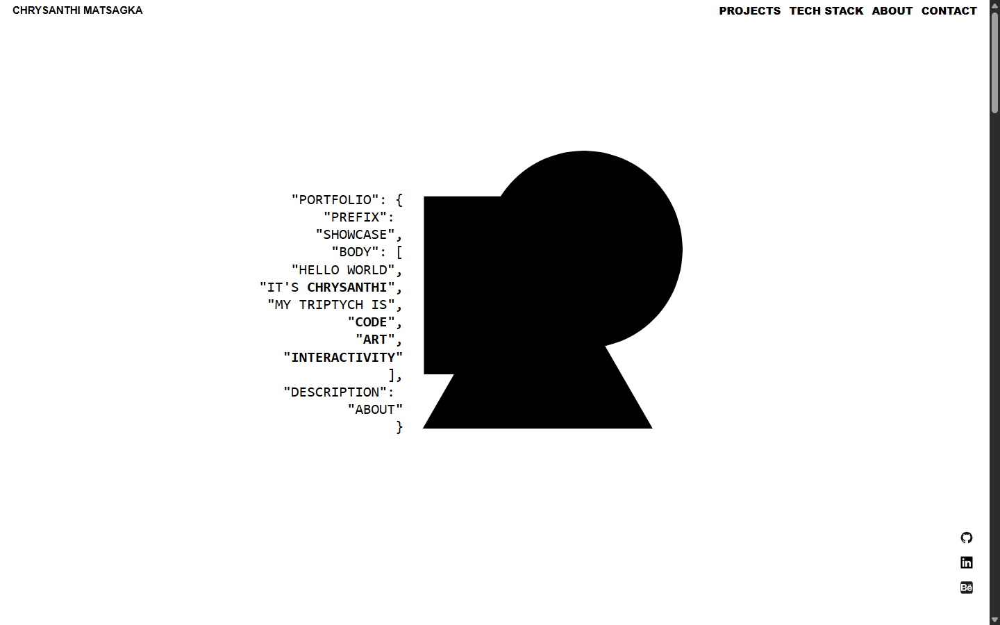
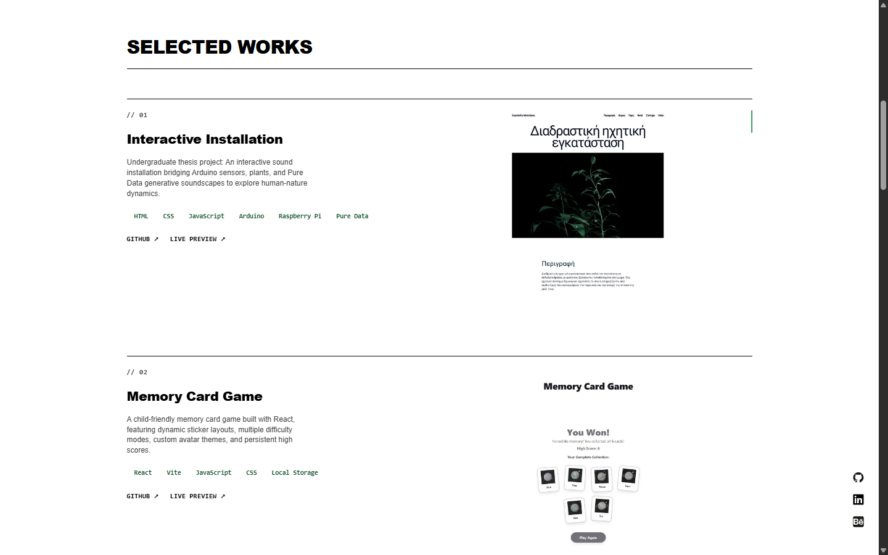

# Creative Developer & Designer Portfolio

A clean, responsive, and accessible portfolio website built to showcase web development projects and technical skills. Designed with a strong focus on core web fundamentals, performance optimization, and modular architecture.

[View Live Application](https://cmatsagka.github.io/portfolio/)

|                     Desktop Hero Overview                     |                        Selected Work Preview                        |
| :-----------------------------------------------------------: | :-----------------------------------------------------------------: |
|  |  |

## 🎯 Key Engineering & Design Highlights

- **Core Web Standards:** Built using semantic HTML5 landmarks, clean CSS custom properties, and modern layout systems (CSS Grid & Flexbox) to ensure robust responsiveness across all viewports.
- **Accessibility (a11y):** Prioritizes screen reader compatibility, explicit keyboard focus states, and proper ARIA labeling for an inclusive user experience.
- **Performance & SEO:** Optimized asset delivery, local font bundling, and semantic markup structure ensure fast load times and clean search engine indexing.
- **Modular Vanilla JavaScript:** Utilizes ES6+ modules and native DOM templates (`<template>`) to render dynamic project data securely without heavy frontend framework overhead.
- **Design Principles:** Employs clean typographic hierarchy, deliberate white space, and Gestalt principles (proximity and alignment) to maintain a readable, scannable user interface.

---

## 🛠️ Tech Stack

- **Languages:** HTML5, CSS3, JavaScript (ES6+)
- **Styling:** CSS Custom Properties, Flexbox, Grid, Responsive Media Queries
- **Tooling & Bundling:** Webpack, npm
- **Typography:** Self-hosted web fonts via `@fontsource` for reliable, tracking-free offline/online loading

---

## 📁 Repository Structure

```text
├── src/
│   ├── assets/             # Optimized images and media
│   ├── projects.js         # Dynamic project rendering logic
│   ├── projectsData.js     # Data source for portfolio projects
│   ├── techStackRender.js  # Dynamic tech stack rendering logic
│   ├── techStackData.js    # Data source for tech stack
│   ├── styles.css          # Core styles and responsive rules
│   ├── template.html       # Semantic HTML markup
│   └── index.js            # Main JavaScript orchestration entry point
├── dist/                   # Production build output (Webpack)
├── package.json            # Project dependencies and build scripts
└── webpack.config.js       # Bundling and asset configuration
```

## 🚀 Local Installation

### Prerequisites

Ensure you have [Node.js](https://nodejs.org/) installed locally.

### Step-by-Step Setup

1.  **Clone the repository:**

    ```bash
    git clone git@github.com:cmatsagka/portfolio.git

    cd portfolio
    ```

2.  **Install project dependencies:**

    ```bash
    npm install
    ```

3.  **Launch the development server:**

    ```bash
    npm start
    ```

4.  **Build for production:**

    ```bash
    npm run build
    ```

## ✉️ Connect

Whether you want to discuss creative coding, frontend development workflows, or potential collaborations at the intersection of art and tech, feel free to connect via LinkedIn or view my source code on GitHub.
